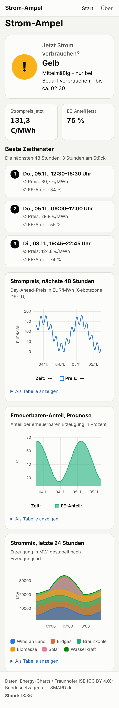

# Strom-Ampel

Open-Source-WebApp für Deutschland (Gebotszone DE-LU). Sie zeigt live den Strommix, den Day-Ahead-Preis und den Anteil erneuerbarer Energien, und sagt per Ampel, ob jetzt ein günstiger Zeitpunkt ist, Strom zu verbrauchen. Zusätzlich werden die besten Zeitfenster der nächsten 48 Stunden gezeigt, etwa für Waschmaschine oder E-Auto.



> Die Screenshots zeigen **synthetische Testdaten**, keine echten Marktwerte.

## Status

Umgesetzt sind Ampel, Zeitfenster, API, Diagramme, PWA, ICS-Export und Morgen-Hinweis per Web-Push. **Die Anbindung der Datenquellen fehlt noch:** Die Adapter für Energy-Charts und SMARD sind noch nicht implementiert. Bis dahin hat die Datenbank keine Live-Daten, und die Seite zeigt „Keine aktuellen Preisdaten“. Den Fortschritt siehe [CHANGELOG.md](CHANGELOG.md).

## Funktionen

- **Ampel** „Jetzt Strom verbrauchen?“ mit Grün, Gelb oder Rot, immer zusammen mit Symbol und Satz, nie nur über Farbe.
- **Beste Zeitfenster** der nächsten 48 Stunden, jeweils 3 Stunden am Stück.
- **Diagramme** für Strompreis, Erneuerbaren-Anteil (Prognose) und Strommix der letzten 24 Stunden, jeweils mit Tabellenansicht.
- **PWA:** installierbar, zeigt den letzten gespeicherten Stand auch offline.
- **Kalender-Export** der Zeitfenster als ICS unter `/api/windows.ics`.
- **Morgen-Hinweis** per Web-Push (optional, braucht VAPID-Schlüssel).
- **JSON-API** für eigene Automationen, siehe unten.
- Mobile-first, Hell- und Dunkelmodus, deutsche Oberfläche.

## Schnellstart mit Docker

Voraussetzung: Docker mit Compose v2.

```bash
cp .env.example .env
# Für HTTPS mit automatischem Zertifikat in .env eintragen:
# DOMAIN=strom.example.de   (DNS muss auf den Server zeigen, Ports 80 und 443 frei)
docker compose up -d --build
docker compose ps            # "healthy" für die App
```

Die Daten liegen im Volume `strompreise-data`. Ein Neustart behält sie. Ohne `DOMAIN` läuft Caddy mit `localhost` und einem lokalen Zertifikat.

## Schnellstart lokal

Voraussetzung: Node.js 22 oder neuer.

```bash
npm ci
cp .env.example .env
npm run dev                  # http://localhost:5173
```

Für einen Produktionslauf ohne Docker: `npm run build && node build/index.js`.

## Konfiguration

Alle Einstellungen stehen in `.env` (Vorlage: `.env.example`). Die Datei wird nicht committet.

| Variable                                 | Standard                       | Bedeutung                                                            |
| ---------------------------------------- | ------------------------------ | -------------------------------------------------------------------- |
| `DATABASE_PATH`                          | `./data/strompreise.db`        | SQLite-Datei (im Docker-Image `/data/strompreise.db`)                |
| `MIGRATIONS_DIR`                         | `src/lib/server/db/migrations` | Ordner mit den Datenbank-Migrationen                                 |
| `JOBS_ENABLED`                           | `true`                         | Hintergrund-Jobs starten (`false` schaltet sie ab)                   |
| `USER_AGENT_CONTACT`                     | Repo-URL                       | Kontakt im User-Agent der Upstream-Abfragen                          |
| `AMPEL_WEIGHT_PRICE`                     | `0.5`                          | Gewicht des Preis-Anteils im Score                                   |
| `AMPEL_WEIGHT_RENEWABLE`                 | `0.5`                          | Gewicht des EE-Anteils im Score                                      |
| `AMPEL_GREEN_MIN`                        | `0.66`                         | Ab diesem Score ist die Ampel grün                                   |
| `AMPEL_YELLOW_MIN`                       | `0.33`                         | Ab diesem Score ist die Ampel gelb, darunter rot                     |
| `VAPID_PUBLIC_KEY` / `VAPID_PRIVATE_KEY` | leer                           | Web-Push aktivieren. Erzeugen mit `npx web-push generate-vapid-keys` |
| `VAPID_SUBJECT`                          | Repo-URL                       | Kontakt für Push-Dienste (`https:` oder `mailto:`)                   |
| `DOMAIN`                                 | `localhost`                    | Nur Docker: Domain für Caddy und automatisches HTTPS                 |

Die Ampel-Gewichte und Schwellen wirken sofort nach einem Neustart. Ohne VAPID-Schlüssel bleiben die Push-Endpunkte aus (HTTP 503), und der Hinweis-Schalter wird nicht angezeigt.

## Die Ampel

Jedes Intervall der nächsten 48 Stunden bekommt einen Score zwischen 0 und 1:

- **Preis:** je günstiger im Vergleich zu den übrigen Stunden, desto höher (Mittelrang-Perzentil, negative Preise sind also ganz vorn).
- **Erneuerbaren-Anteil:** Prognose in Prozent, auf 0–100 begrenzt.

Beide Teile gehen gewichtet ein. Fehlt einer, wird nur der andere verwendet. Fehlen beide, ist die Ampel „unbekannt“. Ab 0,66 ist sie grün, ab 0,33 gelb, darunter rot. Die Methode steht auch auf der Seite „Über“.

## JSON-API

| Endpunkt                               | Inhalt                                                      |
| -------------------------------------- | ----------------------------------------------------------- |
| `GET /api/now`                         | aktueller Mix, Preis, EE-Anteil, Ampel und Datenstand       |
| `GET /api/forecast`                    | Preise und EE-Prognose der nächsten 48 Stunden              |
| `GET /api/windows?duration=3h&count=3` | beste Zeitfenster (Dauer 15 min bis 12 h, 1 bis 10 Fenster) |
| `GET /api/windows.ics`                 | dieselben Fenster als Kalenderdatei                         |
| `GET /api/status`                      | Frische und letzter Fehler je Datenquelle, Healthcheck      |

Beispiel für eine Home-Assistant-REST-Sensor-Konfiguration (Platzhalter anpassen, nicht getestet):

```yaml
sensor:
  - platform: rest
    resource: https://strom.example.de/api/now
    value_template: '{{ value_json.ampel.farbe }}'
    scan_interval: 900
```

Für evcc gibt es hier keine fertige Anleitung. Die Endpunkte liefern JSON und lassen sich bei Bedarf einbinden; ob und wie evcc den Wert nutzt, ist nicht geprüft.

## Datenquellen

- **Energy-Charts** des Fraunhofer ISE, primär, Lizenz CC BY 4.0 (Adapter folgt).
- **SMARD** der Bundesnetzagentur, Ausweichquelle ohne Schlüssel, wenn Energy-Charts ausfällt (Adapter folgt).

Die Anwendung ruft die Quellen nicht bei jedem Seitenaufruf ab. Hintergrundjobs holen die Daten: Strommix alle 15 Minuten, Preise und Prognose stündlich, Morgen-Hinweis täglich um 18:00. Daten älter als 90 Tage werden zu Stundenmitteln verdichtet.

Quellenhinweis für die Oberfläche: _Daten: Energy-Charts / Fraunhofer ISE (CC BY 4.0); Bundesnetzagentur | SMARD.de_

## Entwicklung

| Befehl                       | Zweck                                          |
| ---------------------------- | ---------------------------------------------- |
| `npm run lint`               | Prettier-Prüfung und ESLint                    |
| `npm run check`              | Typprüfung für App und Service Worker          |
| `npm run test:unit -- --run` | Unit-Tests (Vitest)                            |
| `npm run test:e2e`           | E2E-Tests (Playwright, braucht einen Chromium) |
| `npm test`                   | Unit- und E2E-Tests                            |
| `npm run db:generate`        | Migration aus dem Schema erzeugen              |

E2E-Tests brauchen einen Browser: `npx playwright install chromium`. Liegt bereits ein Chromium vor, kann sein Pfad über `PLAYWRIGHT_CHROMIUM_PATH` angegeben werden.

CI (GitHub Actions) führt bei jedem Push Lint, Typprüfung, Unit- und E2E-Tests aus.

## Mitwirken

Beiträge sind willkommen. Bitte vor größeren Änderungen ein Issue öffnen. Vor einem Pull Request sollten `npm run lint`, `npm run check` und `npm test` grün sein. Neue Logik gehört als reine Funktion in `src/lib/server/logic/` und bekommt Tests. Nutzer-Anfragen lesen nur aus der Datenbank, nie direkt von Upstream-APIs.

## Lizenz

GNU Affero General Public License v3.0, siehe [LICENSE](LICENSE). Wer die Software verändert und als Netzwerkdienst betreibt, muss den geänderten Quellcode den Nutzenden anbieten (AGPL-3.0, Abschnitt 13).
